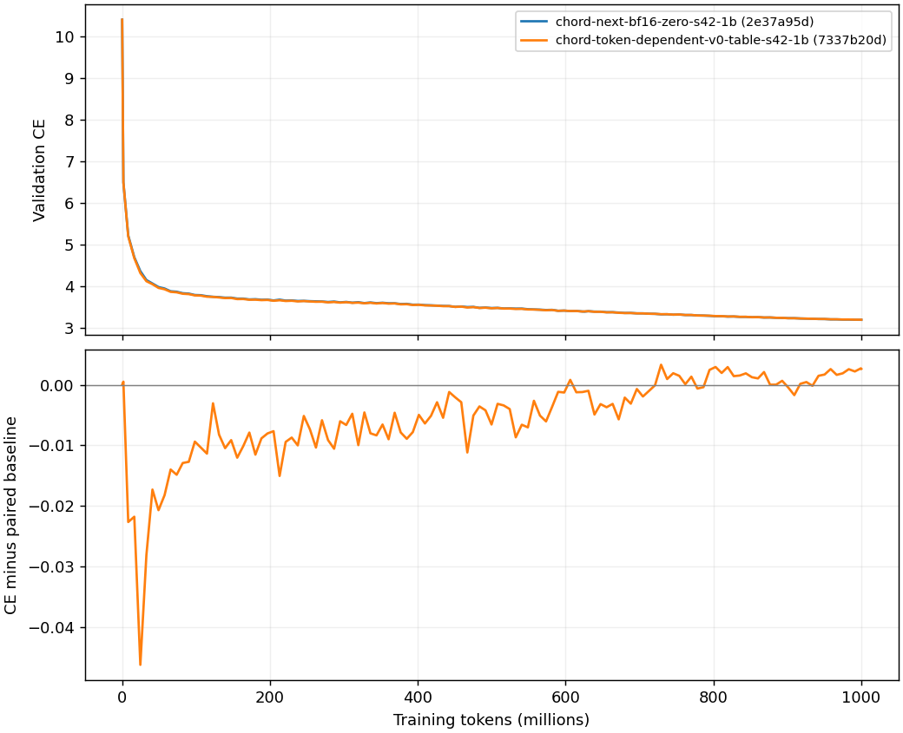

# Chord 的初速度需要独立词表吗？

## 假设与实验设计

研究对象为六系数 token-dependent Chord。新实验默认查独立 token 速度表，也可选从归一化 h0 生成或从静止开始。本组以相同训练预算比较这三种选择。

本轮以已完成的 h0 生成版（2e37a95d）为参照，新增零初速、独立速度表两个完整 Chord 实验。假设是初速度的来源会改变早期及最终 CE。三者共用 vanilla 主干、六系数 token-dependent 更新、数据顺序、seed 42 和 1B 学习率日程。

判据是完整预算下的 validation CE 差值，并检查差距在训练中的变化。并列报告参数量、训练 FLOPs、同型号 GPU 上的吞吐及峰值显存。两种初速度的参数量和优化器分组均有差异，结论适用于这一整体替换。

## 实验事实

<!-- sync:begin -->

| 配置 | 状态 | 验证 tokens | 最近 CE | ΔCE | 基线 |
|---|---|---:|---:|---:|---|
| [chord-token-dependent-v0-table-s42-1b](configs/7337b20d.json) | 已完成 | 1000013824 | 3.19960 | 0.00264 | 2e37a95d |

[完整验证曲线数据](curves.csv)

<!-- sync:end -->

## 分析、结论与待验证问题

在这组切向 Chord 中，1B 终点 CE 分别为 h0 生成 3.196963、查表 3.199604、零初速 3.207224。两个已归档配置仍可作为配对基线。[h0 生成](../legacy-chord-1b/configs/2e37a95d.json) · [零初速](../legacy-chord-1b/configs/aa44a2d7.json)

待验证问题：与 h0 生成相比，查表和零初速在同一 1B 日程下的 CE 曲线、最终 CE 和达到相同 CE 的时间如何变化？

<!-- agent:begin -->

<!-- reviewed: 7337b20d@已完成@1000013824@3.19960@0.00264 -->

**实测结论** 在相同协议和 seed 42 下，三种配置均完成了 1,000,013,824 个训练 tokens。从归一化 h₀ 投影生成初速度的基线（2e37a95d）最终验证 CE 最低，为 3.196963，独立速度表为 3.199604（ΔCE +0.002641），零初速为 3.207224（ΔCE +0.010261）。各自的验证曲线保存在研究目录和 Legacy 归档。

**分析** 查表与零初速的 CE 从同一起点波动下降，查表在全部 124 个共同的非零 token 验证点上都更低，优势在 212,992,000 tokens 时最大（0.015947），终点为 0.007620。查表比零初速多用 16,777,216 个参数，两者的估算训练量均约为 3.04×10¹⁷ FLOPs，但分别使用 H200 和 H100，吞吐和峰值显存缺少同型号 GPU 对照。推测 h₀ 投影可能受益于跨 token 共享参数，但本次只有一个种子，且参数量与优化器分组随方案改变，无法单独归因。

**待验证** 在匹配参数预算和优化器设置的多种子配对实验中，h₀ 投影能否在 1B tokens 时稳定取得比独立速度表更低的验证 CE？

<!-- agent:end -->
