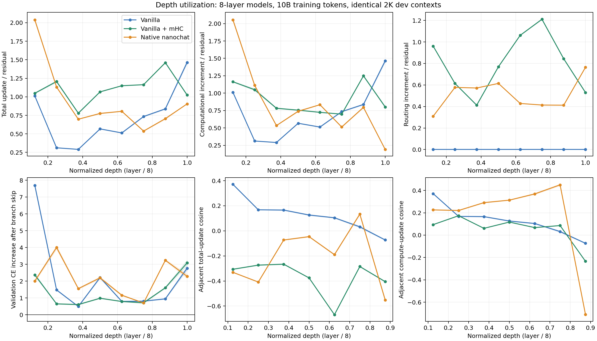
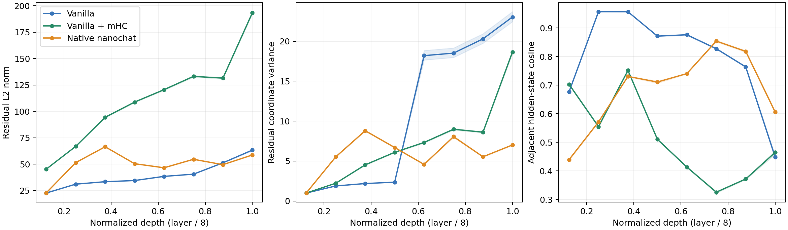

**2K 层间深度利用诊断报告 — 2026-11-03**

结论：在我们这三个 8 层、10B-token checkpoint 上，没有观察到“后半层基本无用、可以轻易删除”的现象。mHC 的计算分支重要性相对 vanilla 更偏向后层，主要体现在第 7、8 层，同时对第 1 层的依赖明显降低。这支持“依赖在深度方向上重新分配”，还不能证明更强的组合推理，也不能把质量改善完全归因于这一机制。

三篇论文提出的现象值得研究，但不能将“hidden 相似”“更新小”“可删除”和“不能组合计算”当作同一个结论。下面区分实测结果与尚未检验的解释。

**模型与评估条件**

三组均使用完成 305176 步的 latest checkpoint（非按本次结果选择 best），训练 10,000,007,168 tokens、seed 42、8 层、D=512、4 heads。原始 train/dev/test 的 token 内容一致。此次使用原 dev 全部 64 个 2048-token 上下文，共 131072 个 NTP targets；不访问 test 来选择结论。统一 H200、BF16、cuDNN attention、softcap 15 与全词表 CCE。下列 CE 为本次重新评估值。

| 模型 | 参数量 | W&B 历史 ID | 本次 baseline dev CE | 与训练末记录差值 |
|---|---:|---|---:|---:|
| Vanilla | 58.720M | 6a07f085 | 3.18127981 | -2.83e-05 |
| Native nanochat | 125.829M | 84ed009b | 3.03835831 | -5.10e-05 |
| Vanilla＋mHC | 59.515M | 048c708c | 3.08285916 | -2.51e-05 |

Native 使用 SSSL、value embeddings、smear、x0 注入、residual scaling 和 backout；其参数量约为另外两组的两倍。mHC 这里指 vanilla＋mHC，不是 native＋mHC。因此 vanilla 与 mHC 是主要的连接结构对照，native 是完整架构的描述性对照。三组训练时的历史软件版本也不完全相同；此次统一后端后 CE 偏差不超过 5.1e-5。

**如何定义更新与跳层**

每层包括 attention 与 MLP。h_l 取层边界处、native 的缩放/x0 注入之前的状态；h_after 取 MLP 写回之后、下一层 routing 或最终读出之前的状态。mHC 在完整 D×K=2048 维 residual 空间测量，不提前汇合 stream。

总更新 Δ = h_after − h_l。对每个 sublayer，用普通前向已计算的同一组 routing 系数再执行一次零分支写回，得到 pure_routed。计算增量 = actual_output − pure_routed；routing 增量 = pure_routed − sublayer_input。整层分别相加，native 还把 residual scaling/x0 注入计入 routing。总更新等于二者之和（包含实际 BF16 写回舍入）；二者的范数不能直接相加。这是局部增量记账，不是 attention 增量经过后续 routing 传输后的因果归因。

每次仅关闭一个 block 的 attention＋MLP 计算；保留 mHC 的 H_res/H_post 等 routing，第二个 connector 根据干预后的输入重新计算。Native 保留缩放、x0、smear 与 backout，后者使用干预路径上的第 5 层输出（源码 0-based 索引 4）。无 KV cache，不通过改 checkpoint 或删整层来做干预。

**逐层功能重要性：关闭计算分支后的 ΔCE，越大表示当前模型越依赖该层**

| 层 | 归一化深度 l/8 | Vanilla | Native | mHC |
|---:|---:|---:|---:|---:|
| 1 | 0.125 | 7.69707 | 2.00566 | 2.37495 |
| 2 | 0.250 | 1.47942 | 4.00380 | 0.65121 |
| 3 | 0.375 | 0.49449 | 1.55571 | 0.61073 |
| 4 | 0.500 | 2.21708 | 2.19873 | 0.98560 |
| 5 | 0.625 | 0.79563 | 1.16447 | 0.79161 |
| 6 | 0.750 | 0.81205 | 0.70390 | 0.71461 |
| 7 | 0.875 | 0.94906 | 3.24405 | 1.60909 |
| 8 | 1.000 | 2.76790 | 2.28847 | 3.08543 |

三组全部 24 个单层干预都增加了 loss；最小平均增幅分别为 vanilla 0.49449、native 0.70390、mHC 0.61073。各自最小的逐序列 bootstrap 95% 区间下界仍分别为 0.47685、0.68868、0.57950。因此这里没有看到“删除某个后层几乎无代价”。高 hidden cosine 也不等于无用：例如 vanilla 第 2 层前后 hidden cosine 约 0.957，但关闭该层使 CE 增加约 1.479。

| 模型 | 前半层平均 ΔCE（1–4） | 后半层平均 ΔCE（5–8） | 后半层正敏感度占比 |
|---|---:|---:|---:|
| Vanilla | 2.97201 | 1.33116 | 30.93% |
| Native nanochat | 2.44097 | 1.85022 | 43.12% |
| Vanilla＋mHC | 1.15562 | 1.55019 | 57.29% |

这里的占比是后半层单独消融的正 ΔCE 之和 / 全部层之和，仅描述敏感度分布。各层消融效果不可相加为模型总性能，也不能解释为“57% 的能力来自后半层”。Vanilla 的前半层平均值尤其受到第 1 层巨大影响的支配。

mHC 后半层的平均 ΔCE 比 vanilla 高 **0.21903（约 16.45%）**，同序列 paired bootstrap 95% 区间为 **[0.20289, 0.23513]**。排除最后一层、只看第 5–7 层，差值仍为 **+0.18619 [0.16905, 0.20096]**。但这并非所有后层都增强：第 5 层差值 −0.00402，区间跨 0；第 6 层为 −0.09744；第 7、8 层分别为 **+0.66004、+0.31753**。同时第 1 层由 +7.69707 降至 +2.37495。

所以更准确的说法是：**mHC 降低了对最早层的极端依赖，并提高了对靠近输出端的部分计算分支的依赖。** 这与更好的 baseline CE 同时出现，但不能证明这是 CE 改善的原因。Native 第 2、7 层尤其重要，呈现另一种非单调分布；不能据此作等参数效率排名。

**相对更新幅度：逐 token 的 ||Δ||/||h_l|| 再平均**

| 层 | Vanilla 总更新 | Native 总更新 | mHC 总更新 | mHC 计算增量 | mHC routing 增量 |
|---:|---:|---:|---:|---:|---:|
| 1 | 1.0119 | 2.0382 | 1.0482 | 1.1638 | 0.9609 |
| 2 | 0.3119 | 1.1317 | 1.2067 | 1.0492 | 0.6145 |
| 3 | 0.2906 | 0.6975 | 0.7795 | 0.7829 | 0.4123 |
| 4 | 0.5671 | 0.7757 | 1.0670 | 0.7556 | 0.7696 |
| 5 | 0.5127 | 0.8043 | 1.1495 | 0.7242 | 1.0618 |
| 6 | 0.7340 | 0.5375 | 1.1638 | 0.6982 | 1.2109 |
| 7 | 0.8377 | 0.7054 | 1.4610 | 1.2484 | 0.8435 |
| 8 | 1.4641 | 0.9045 | 1.0243 | 0.8015 | 0.5302 |

Vanilla 第 5–8 层的平均相对更新为 0.513、0.734、0.838、1.464，并没有逐步趋近于零。mHC 的总变化很大，但相当一部分来自 routing；例如第 6 层总变化 1.164，计算增量 0.698，routing 增量 1.211。不能把这 1.164 全算成新的 attention/MLP 信息。

Native 最后一层总更新比值约 0.904，其中计算增量只有 0.190、routing 约 0.764；然而关闭其计算仍让 CE 增加 2.288。幅度较小的方向性调整可以对最终 logits 很重要。最终 backout 单独记录，平均相对变化约 0.435，不混入第 8 层的 Δ。

整批 Frobenius 比值 sqrt(sum ||Δ||² / sum ||h||²) 也已保存。Vanilla 第 4、5 层在此口径下是 **2.620、0.192**，而逐 token 平均是 **0.567、0.513**。这说明表示幅值的异质性会显著改变汇总结果，不能选一个口径笼统宣布“中部发生了失效”。第一篇论文的相对贡献定义采用逐 token 比值的平均，与主图口径一致。全部两种口径见 CSV/JSON。

**相邻更新方向：总更新与计算增量必须分开**

| 相邻层 | Vanilla 总/计算 cosine | Native 总 cosine | Native 计算 cosine | mHC 总 cosine | mHC 计算 cosine |
|---|---:|---:|---:|---:|---:|
| 1→2 | +0.3709 | -0.3308 | +0.2260 | -0.3063 | +0.0943 |
| 2→3 | +0.1680 | -0.4083 | +0.2207 | -0.2732 | +0.1738 |
| 3→4 | +0.1659 | -0.0730 | +0.2909 | -0.2658 | +0.0610 |
| 4→5 | +0.1264 | -0.0461 | +0.3132 | -0.3752 | +0.1170 |
| 5→6 | +0.1043 | -0.1897 | +0.3688 | -0.6687 | +0.0676 |
| 6→7 | +0.0320 | +0.1335 | +0.4500 | -0.2845 | +0.0858 |
| 7→8 | -0.0728 | -0.5517 | -0.7090 | -0.4052 | -0.2336 |

mHC 的总更新相邻 cosine 全为负，第 5→6 层甚至约 −0.669；但排除局部 routing 增量后，该对计算增量的 cosine 为 +0.068。这个差异表明原始总 Δ 会强烈反映跨层混合，不能直接解释为 attention/MLP 在互相撤销或进行完全不同的推理。总更新与计算增量都在固定的完整 residual 坐标里比较，没有把向量搬运到随 routing 变化的坐标系。

零向量 cosine 标记为未定义并排除，记录有效 token/sequence 数，不填 0。本次所有整层相邻总更新的比较均有完整 131072 个有效 token；部分 sublayer 的 update–residual cosine 存在零更新边界情况。

第二张图中的 mHC 范数为完整 4-stream L2 范数，不能直接按其绝对大小与单流排名；初始扩流本来就会让 L2 范数约翻倍。主比较使用无量纲相对幅度。

**对三篇论文的判断**

1. [Do Language Models Use Their Depth Efficiently?](https://arxiv.org/html/2505.13898v3)：正确 arXiv ID 是 **2505.13898**。原文明确区分当前输出与后续 token 的可复用计算，后层仍可能对当前预测很重要。我们的结果不支持把其“大模型后半段相对更新偏小”直接套到全部 8 层模型；但较大的 NTP 消融损失并不反驳其关于未来 token 的结论。本次没有做 prefix-only 干预、多跳任务或跨深度 learned mappings，因此不检验其更强的组合计算解释。

2. [Inverse Depth Scaling From Most Layers Being Similar](https://proceedings.mlr.press/v306/liu26bt.html)（[全文](https://arxiv.org/html/2602.05970v2)）：论文的证据包括相邻更新相关性较弱，而不是要求更新向量接近平行。我们的 vanilla 中后部及 mHC 的计算增量确实多为弱相关，和这个观察相容；native 则呈不同的方向模式。但三个模型都只有 8 层，**不能检验 inverse-depth scaling**，也不能仅靠 cosine 就确认 ensemble averaging 或排除组合计算。

3. [The Curse of Depth in Large Language Models](https://arxiv.org/html/2502.05795v6)：这里能观察到 vanilla/mHC 的 residual 方差增长，但没有伴随“后半层几乎可无损删除”；native 方差并不单调。其理论使用分布与独立性假设，并讨论方差增长界及特定增长情形；指数上界不等于每个训练模型实际按指数增长。本次也没有测 block Jacobian 或更换 normalization 重新训练，所以不能验证“Pre-LN 是根本原因”这一因果解释。

我的判断是：**论文中报告的经验现象不能简单判为假，但“普通 Transformer 的后半层普遍无用”是过度概括。我们的模型已有明显的后层依赖，mHC 又改变了这种依赖的分布。** 如果要把深度利用作为下一步架构研究的 motivation，应先确认更深的受控 baseline 是否真的出现可删、弱贡献的后层；当前结果不足以支持“先修复我们现有 8 层模型后半层失效”这个出发点。本次没有启动任何新训练。

**证据范围与验证**

这是三个单 seed、单训练预算、单 dev 数据集的冻结 checkpoint 比较。报告的 95% 区间以 64 个 packed sequences 为重采样单位（4000 次、seed42），是样本内不确定性，不覆盖训练 seed 或不同架构超参的不确定性；packed 序列也不保证独立文档。区间是逐项区间，未作多重比较校正。跳层属于训练分布之外的干预，ΔCE 衡量依赖性，而非训练效率或可重训压缩后的损失。没有把 8 层结果当成对几十层、数十亿参数模型的完整复现。

GPU 作业 **7777460.0** 正常 exit0。5 项独立基础检查通过；三组原前向、全部 24 个跳层前向与独立置零 hook 参考逐位一致；确认跳层时计算分支没有被执行；计算/routing 分解最大绝对误差 2.15e-6；权重及所有 buffers（含非持久 RoPE buffers）前后指纹一致。生产模型和训练代码未改动，无 optimizer、无 W&B 新 run、无权重输出。诊断主体约 51.74 秒，不含排队、环境准备和绘图。前两次失败均保留在 failed-attempts.json：一次 synthetic fixture 元数据不完整，一次零向量 cosine 的统计边界；均没有放宽数值阈值。

**可复查文件**

- [完整数值与逐层/子层置信区间](results/results.json)
- [每层 CSV](results/per-layer.csv)
- [配对比较与置信区间](results/paired-comparison.json)
- [Vanilla 逐序列数据](results/vanilla-per-sequence.npz)、[Native](results/native-per-sequence.npz)、[mHC](results/mhc-per-sequence.npz)
- [主图 PDF](results/comparison.pdf)、[表示几何 PDF](results/residual-geometry.pdf)
- [输入 checkpoint、源码与检查审计](results/audit.json)、[方法与复现说明](README.md)

执行源码：`86cc14f6b0d39d08fc98d5e986e57f1837c2f55d`；模型文件保持 `f9e5b3d` 回退后的实现。
