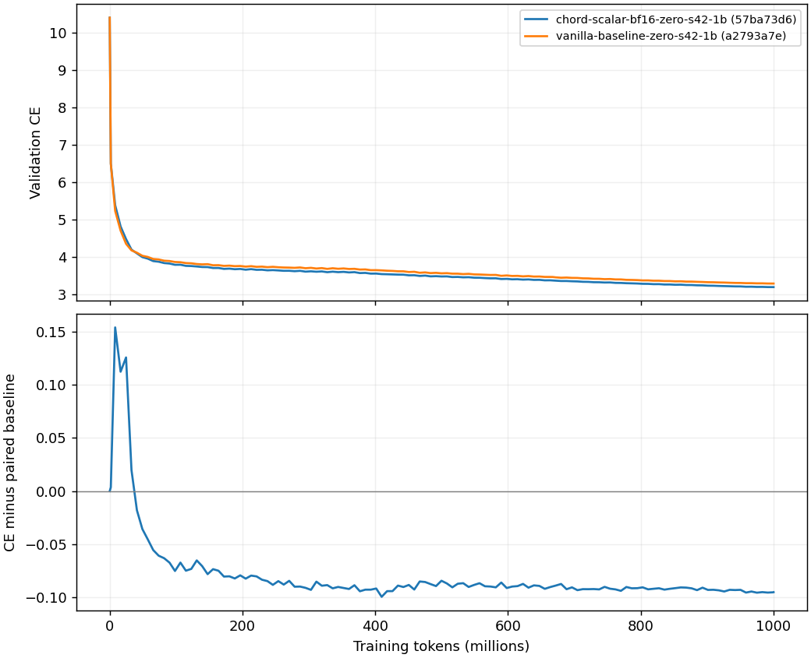

# Legacy · 早期 Scalar Chord 1B 实验

## 结论

旧四标量完整版的最终 validation CE 为 3.19776（查表）和 3.20808（零初速）。它们使用 target-based 位置更新，两个速度写入系数均为 1−β。当前 token-dependent 的六系数版本使用 update-based 写入，初速度研究另行配对。

## Scalar Chord 从静止出发的分量消融

沿用 vanilla 1B 协议、seed 42、BF16 和零输出投影，三条均从头训练。起点采用 Next 静态标量版的 v0=0。两条含速度的配置直接创建零张量；三条均无速度表或初速度投影。主干和学习率沿用 nanochat，球面分支使用当前 soft-force τ=0.05。[Next 标量版公式](https://github.com/lululu39/NextTransformer/blob/chordres-zero/nexttransformer/methods/chordres_zero/README.md)

| 配置 | 分支读取和位置更新 | 速度更新 |
| --- | --- | --- |
| 完整 Scalar，从静止出发 | 前瞻读取；沿速度、垂直速度两个标量步长，朝 soft-force 目标更新并回到单位 RMS 球面 | 用 β 混合旧速度与实际位移，再投影到终点切平面 |
| 仅球面写入 | 从 h 读取；保留一个正标量步长 α，更新为 N(h + α × (soft(F) − h)) | 无速度状态 |
| 仅速度前瞻 | 从 h + μv 读取并做原有 pre-norm；用 h′ = h + F 更新位置 | v′ = βv + (1 − β)(h′ − h)，在欧氏空间记录实际位移 |

有前瞻的子层均使用可学习标量 μ（初值 0）；有后续读取的速度使用可学习 β（初值 0.5）。球面写入的步长初值为 0.05。完整从静止版本和原 vanilla 基线 a2793a7e 配对；两条消融直接对比本次完整从静止版本。结合四组同 token 的 CE 可判断两个分量各自的收益，以及组合是否存在交互。

## 实验事实

<!-- sync:begin -->

| 配置 | 状态 | 验证 tokens | 最近 CE | ΔCE | 基线 |
|---|---|---:|---:|---:|---|
| [chord-scalar-bf16-zero-s42-1b](configs/57ba73d6.json) | 已完成 | 1000013824 | 3.19776 | -0.09489 | a2793a7e |
| [chord-scalar-from-rest-v0zero-s42-1b](configs/9c3d50ec.json) | 已完成 | 1000013824 | 3.20808 | — | a2793a7e |
| [chord-scalar-lookahead-only-v0zero-s42-1b](configs/62357991.json) | 主动终止 | — | — | — | 9c3d50ec |
| [chord-scalar-sphere-only-v0zero-s42-1b](configs/da4e2ef3.json) | 主动终止 | — | — | — | 9c3d50ec |

[完整验证曲线数据](curves.csv)

<!-- sync:end -->

## 来源与覆盖范围

- 57ba73d6 的配置和训练摘要取自原作业 9090785.0 回传包，验证曲线取自此前完整同步的 W&B 缓存。
- 9c3d50ec 的正式训练摘要记录了 30,518 步和终点 CE，保留摘要中的起点和终点。da4e2ef3 在训练中停止，最后记录第 3,550 步。62357991 完成工程预检后取消，正式训练步数为零。三条的来源为作业 9093243.0 的正式日志及停止记录。
- 查档时 W&B API 未返回这四个 run。本地归档保留原实验 ID、来源配置、可验证指标和训练状态，活动 leaderboard 排除这四条。[冻结指标](runs.json)
