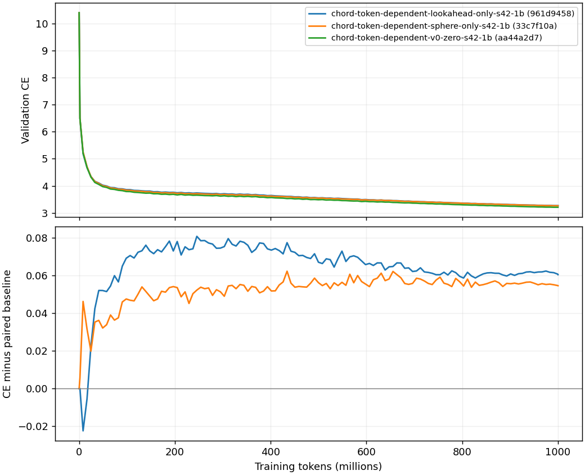

# 零初速的 Chord，球面更新与速度前瞻各贡献多少？

本报告归档于默认速度几何切换为 ambient 时。配对参照为零初速、仅投影的完整 Chord（aa44a2d7）。

## 假设与实验设计

比较完整 token-dependent Chord（零初速，aa44a2d7）与两个独立消融。三组均从零训练，seed 42，vanilla 8×512、BF16、2K 上下文、零输出投影，使用相同 FineWeb 数据和 1B 学习率日程。控制器只读取当前 token 的 RMSNorm(h)，权重从零开始，调制尺度从 0.01 开始，使用同一 routing AdamW 组。

| 配置 | 分支读取和位置更新 | 速度写入 |
| --- | --- | --- |
| 完整，复用 aa44a2d7 | 球面前瞻，按速度方向拆分 soft force，再归一化位置 | 切平面内分别学习 β、γ∥、γ⊥ |
| 仅球面 | 从 h 读取，h′ = N(h + α(h) soft(F))；α 初值 0.05，soft force 的 τ 为 0.05 | 无速度状态，也无初速度参数 |
| 仅速度前瞻 | 从 h + μ(h)v 读取，保留分支 pre-norm，h′ = h + F | 从 v₀=0 开始，将实际位移 d = h′ − h 按旧速度分解，在欧氏空间写入 β(h)v + γ∥(h)d∥ + γ⊥(h)d⊥ |

仅前瞻组 μ 初值为 0，β 和两个 γ 均从 0.5 开始。末端 FFN 只需要 μ。假设是两种机制在组合后优于单独使用。主指标为与完整零初速 Chord 同 token 的 validation ΔCE，结合 vanilla 基线 a2793a7e 解读各分量相对普通加法的收益。同时记录参数、估算 FLOPs、吞吐、显存和训练时间。

## 实验事实

<!-- sync:begin -->

| 配置 | 状态 | 验证 tokens | 最近 CE | ΔCE | 基线 |
|---|---|---:|---:|---:|---|
| [chord-token-dependent-lookahead-only-s42-1b](../configs/961d9458.json) | 已完成 | 1000013824 | 3.26773 | 0.06050 | aa44a2d7 |
| [chord-token-dependent-sphere-only-s42-1b](../configs/33c7f10a.json) | 已完成 | 1000013824 | 3.26184 | 0.05462 | aa44a2d7 |

[完整验证曲线数据](curves.csv)

<!-- sync:end -->

## 分析与结论

待获得配对学习曲线。

<!-- agent:begin -->

<!-- reviewed: 961d9458@已完成@1000013824@3.26773@0.06050,33c7f10a@已完成@1000013824@3.26184@0.05462 -->

**实测结论** 在 seed 42、同协议的 1,000,013,824 个训练 tokens 处，完整零初速 Chord（aa44a2d7）的验证 CE 为 3.20722（由配对 ΔCE 反推）。两项消融均完成全预算，仅球面更新的 CE 为 3.26184（+0.05462），仅速度前瞻为 3.26773（+0.06050）。本组缺少完整 Chord 的中间验证点和 vanilla 基线（a2793a7e）的 CE，因此只能在终点比较完整 Chord，也无法量化单项机制相对普通残差的收益。

**分析** 两条消融曲线整体下降，仅前瞻在最初三个非零验证点领先，但从 24,576,000 tokens 起，仅球面在余下 121 个配对验证点的 CE 均更低，优势最大为 0.02855，终点收窄至 0.00588。两者估算训练量仅差约 0.074%，仅球面在 H200 上实测为 45.9 万 tokens/s，仅前瞻在 H100 上为 40.8 万 tokens/s，硬件差异使吞吐差距无法归因于架构。推测球面更新与速度前瞻可能互补，但消融也改变了速度写入方式，单一种子的结果不足以分离这些作用。

**待验证** 以同协议的 vanilla 为共同基线，在多个配对种子上，完整零初速 Chord 的最终验证 CE 降幅是否稳定超过仅球面与仅前瞻各自降幅之和？

<!-- agent:end -->
