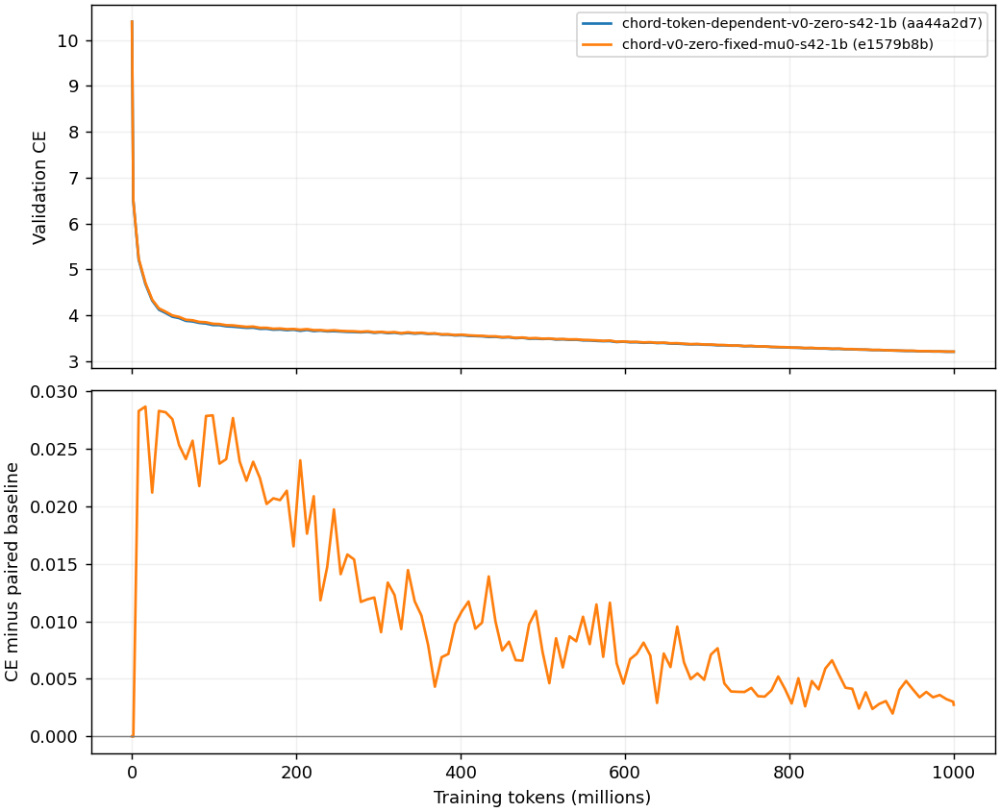

# 保留切向速度时，前瞻读取还能降低多少 CE？

本报告归档于默认速度几何切换为 ambient 时。配对参照为零初速、仅投影的完整 Chord（aa44a2d7）。

## 假设与实验设计

默认 Chord 用速度 v 计算 Attention 和 FFN 的输入，也用 v 分解建议位移并更新速度。这个实验只关闭第一种用途。若前瞻读取有独立贡献，固定 μ=0 后的 validation CE 应高于完整 Chord。

| 零初速配置 | 子层读取 | 位置与速度更新 |
|---|---|---|
| 完整 Chord（aa44a2d7） | 当前 token 决定 μ，读取归一化的 h + μv | 球面位置、双步长、切向速度和两个独立写入增益 |
| 固定 μ=0 | 每个 Attention 和 FFN 均读取经相同 pre-norm 的 h | 同上 |

两边使用 vanilla 8×512、v₀=0、BF16、soft force τ=0.05、零输出投影、同一份 FineWeb-Edu、相同 LR 日程与 seed 42，从零训练 30,518 × 32,768 tokens。消融在融合读取前将 μ 的偏置和 token 调制同时置零，保留完全相同的参数布局和优化器分组。验证记录各子层 μ 的均值与标准差。

按相同训练 tokens 比较 validation CE 曲线。终点 ΔCE 定义为固定 μ=0 的 CE 减去已完成的零初速默认版 CE（3.207224）。已有“仅球面”实验还移除了速度状态，两者可辅助判断读取和写入分别贡献了什么。[配对基线](../configs/aa44a2d7.json) · [组件消融](../chord-components/REPORT.md)

## 实验事实

<!-- sync:begin -->

| 配置 | 状态 | 验证 tokens | 最近 CE | ΔCE | 基线 |
|---|---|---:|---:|---:|---|
| [chord-v0-zero-fixed-mu0-s42-1b](../configs/e1579b8b.json) | 已完成 | 1000013824 | 3.20997 | 0.00275 | aa44a2d7 |

[完整验证曲线数据](curves.csv)

<!-- sync:end -->

## 分析与结论

前瞻读取的条件收益待测。

<!-- agent:begin -->

<!-- reviewed: e1579b8b@已完成@1000013824@3.20997@0.00275 -->

**实测结论** 在零初速、保留切向速度更新的 seed 42 配对实验中，两组均按同一协议完成了 1,000,013,824 个训练 tokens。将 Attention 和 FFN 的前瞻系数 μ 固定为 0 后，最终验证 CE 为 3.209975（e1579b8b），比按 token 学习 μ 的完整 Chord 基线 3.207224（aa44a2d7）高 0.002750。

**分析** 固定 μ=0 的验证 CE 从 10.3980 快速降至约 0.98 亿 tokens 时的 3.8173，随后虽有小幅反弹，仍在约 5 亿 tokens 时降至 3.4921，并在终点达到全程最低值。该配置在 H200 上累计训练步耗时 39.9 分钟，吞吐约 41.75 万 tokens/s，峰值已分配显存为 6.86 GB，估算训练量为 3.04×10¹⁷ FLOPs。推测前瞻读取在保留速度更新时有小幅收益，但本组仅有一个种子的配对终点，缺少基线中途曲线和成本数据，无法判断差距何时出现或前瞻读取增加了多少开销。

**待验证** 在多个随机种子下保持零初速和相同的切向速度更新，按 token 学习 μ 能否在 1B tokens 终点稳定降低配对验证 CE？

<!-- agent:end -->
