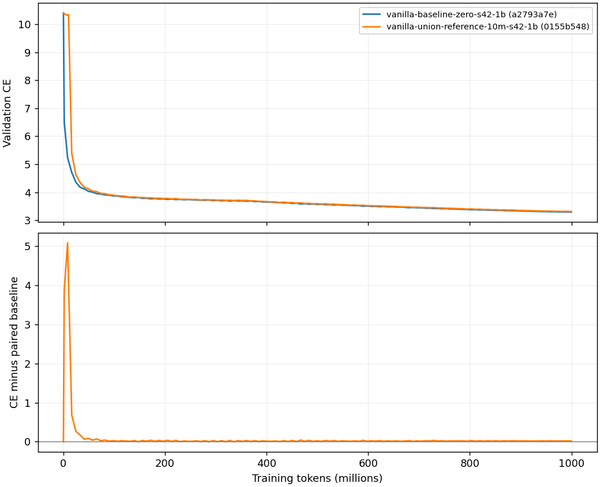

# Procedural pretraining

检验在相同 NanoChat 主干、初始化、训练步数和理论训练 FLOPs 下，将开头一段 FineWeb-Edu 换成程序数据，能否用更少 FineWeb tokens 达到基线的验证 CE。对照组为同一架构、seed、注意力后端和上下文的纯 FineWeb 训练。

## 数据与监督

使用 Jiang 等人公开生成器的 9 个 token 任务。每个输入输出已经是现有 RustBPE 词表内的 ID；模型两端与语言训练共用同一套参数。[论文](https://arxiv.org/html/2601.21725v2) · [原始生成器和配置](https://github.com/zlshinnick/procedural-pretraining/tree/e97ffe3)

| 任务 | 生成和训练目标 |
| --- | --- |
| `identity`、`reverse`、`sort` | 复制、反转或升序排列，只监督答案 |
| `set`、`union` | 单序列或两段序列按首次出现顺序去重，只监督答案 |
| `delete` | 输入给出去除的符号，按公开代码删除其第一次出现，只监督答案 |
| `stack` | 先偏向 push、后偏向 pop，栈内符号唯一，从栈顶到栈底输出，只监督答案 |
| `dyck`、`dyck_shuffle` | 64 对括号，嵌套或按未闭合类型采样。监督同一序列内每个有效下一 token |

输入输出任务默认 64 个输入符号。修正后的生成器在所有训练和验证样本中固定使用原生 ID 1–99，与作者公开配置中的采样范围一致。模型的输入表和读出层均有 32,768 个原生位置。Union 等变换任务按作者算法训练器的 102 类计算 CE（0–99、分隔、填充），Dyck 使用 129 类。FineWeb 始终使用全部 32,768 类。Stack 使用 0 编码 POP，最后两个原生词表 ID 分别用于分隔与填充。第一篇附录 A 将 Union 写作 103 类，发布的生成器在两个分隔位置用同一个 token，训练器实际构造 102 类。本实验采用公开代码的定义。[生成器](https://github.com/zlshinnick/procedural-pretraining/blob/e97ffe3/procedural_data/union.py#L75-L112) · [训练器](https://github.com/zlshinnick/procedural-pretraining/blob/e97ffe3/procedural_pretraining/algorithmic.py#L279-L284)Dyck 默认使用完整上下文，括号配对在整次训练中固定。第一篇的 Rule 110 实验使用专用二值输入和输出投影，公开的 token 生成器不含该任务。

为配对 packed2K 基线，多条独立生成的完整样本放入同一因果上下文，样本间留一个边界位置，尾部填充。新实验在每条样本开头重置 RoPE，用文档掩码隔离样本。程序训练使用 PyTorch 高效 SDPA 的完整因果三角，保持基线的矩阵几何；语言训练沿用 FA2。边界、填充和输入输出任务的提示均不贡献 loss。读出层对所有模型位置做完整 32,768 词表投影，然后取任务类别并做 softmax。梯度按整个优化器 batch 的有效 target 数归一化。

## 两阶段训练

两阶段都使用既有 NanoChat 优化器和 LR 配方。阶段切换时在同一模型上新建优化器，不复制或重置任何模型参数，语言日程从第 0 步按剩余步数运行，FineWeb 从训练缓存第 0 行开始。中断恢复保留所在阶段的模型、优化器、随机状态和数据位置。[整模型迁移协议，附录 A.2](https://arxiv.org/html/2609.38764v1#A1.SS2)

现有训练入口为 `python -m scripts.connection_train`，调度入口为 `research/connections/native/chord/submit.py`。在同一 baseline recipe 上添加以下参数即可启用实验组，省略这些参数即为纯 FineWeb 对照。本次 Union 实验与 vanilla 基线 `a2793a7e` 配对，seed 42，FA2，16 × 2048，保留基线的置零输出投影。

```text
--procedural-task union --procedural-tokens 10000000 --procedural-input-length 64
```

总步数和上下文与基线一致。warm-up 预算按实际模型位置计费，就近取整到每步 32,768 个（正预算至少一步），计入提示和填充。配置记录请求与实际预算。训练记录分别保存 `tokens`、`procedural_tokens`、`procedural_supervised_tokens`、`fineweb_tokens`；总 tokens 对应基线的训练 FLOPs 估计，实测耗时另计。以相同总 tokens 对齐 dev CE 曲线；数据效率以两条曲线首次达到同一基线 CE 所用的 FineWeb tokens 衡量。训练前、切换点和共同的验证步均评估同一份 FineWeb dev。程序阶段在独立随机流生成的固定验证集上记录 `procedural/val_ce` 和有效 target 数，FineWeb 使用 `dev/ce`。

本次整步切分为 305 步 Union（9,994,240 个模型位置）和 30,213 步 FineWeb-Edu（990,019,584 tokens）。总计 1,000,013,824 个模型位置，恰好与基线的 30,518 步相同。

## 首次 Union 实验与诊断

作业 9091044.0（run `10d5b3b2`）已按用户要求停止。它使用旧生成器 `jiang-packed-v1`，每个样本重新抽取 99 个原生 ID。作者的 Union 样本始终从同一套 ID 1–99 采样。旧实现维持了单例去重规则和重复率，改变了跨样本的符号分布。[作者的生成器](https://github.com/zlshinnick/procedural-pretraining/blob/e97ffe3/procedural_data/union.py) · [第一篇论文附录 J](https://arxiv.org/html/2601.21725v2#A10)

| 正式 Union 步数 | 0 | 50 | 250 | 305 |
| --- | ---: | ---: | ---: | ---: |
| 固定验证集 CE | 10.397491 | 10.432450 | 10.558034 | 10.552434 |

验证集含 52,267 个输出位置。全词表均匀预测 CE 为 10.397208。早先预检覆盖梯度、掩码和断点恢复，仅要求验证 CE 有限，未发现这条曲线恶化。修正后的 Union 沿用作者的验证口径，在给定正确答案前缀时，用答案位置上预测正确的 token 数除以全部监督 token 数。训练入口记录 `procedural/val_accuracy`、`procedural/val_ce` 和 FineWeb 的 `dev/ce`，并将两种验证 CE 写入作业日志。按预设步数迁移。[作者的验证代码](https://github.com/zlshinnick/procedural-pretraining/blob/e97ffe3/procedural_pretraining/algorithmic.py#L181-L218)

### 控制实验

在同一张 A100 40GB 上，从同一初始化重跑两种映射。序列结构、监督位置、优化器、学习率日程、验证集大小与已停的正式作业一致。旧映射的验证答案覆盖 26,072 个原生 ID，固定映射覆盖 99 个。两组前 50 步配对，固定映射继续至 305 步。独立验证集含 1,104 条完整样本。

| 映射 | 步数 | 验证 CE | token top-1 | 首输出 top-1 | 整例全对 | 输入分别倒序后的 CE |
| --- | ---: | ---: | ---: | ---: | ---: | ---: |
| 每例随机换 ID | 50 | 10.43245 | 0.004% | 0.00% | 0.00% | 10.43243 |
| 固定 ID 1–99 | 50 | 4.60021 | 1.01% | 0.91% | 0.00% | 4.60020 |
| 固定 ID 1–99 | 150 | 1.98121 | 40.55% | 100.00% | 0.00% | 6.36587 |
| 固定 ID 1–99 | 305 | 0.76737 | 75.16% | 100.00% | 0.00% | 7.08231 |

倒序对照分别反转两段输入，保留输入符号、输出前缀和原始评分答案。旧映射在第 50 步复现了正式作业的 CE。固定映射在第 50 步主要学到了输出字母表，此后能利用顺序预测多数输出 token，但到第 305 步仍未完整答对一条验证样本。整例全对和倒序结果是本地附加诊断。论文图 18 比较了程序验证 loss 与后续 C4 loss，Union 在中等程序 loss 时迁移最好。修正版在 FineWeb 上的数据效率仍待测量。[论文图 18](https://arxiv.org/html/2601.21725v2#A9.F18) · [原始诊断指标](union-diagnostic.json)

另一次相同预算的独立重跑用于定位错误。原验证集 CE 为 0.706，逐 token 正确率为 77.76%；新取的 1,106 条验证样本上分别为 0.710 和 77.49%。在新样本中，输入中紧随前一个正确符号的答案位置正确率为 85.56%，需要先跳过至少一个重复符号的位置为 50.51%。两组样本的首次出错位置中位数均为答案第 20 个 token。

## Union 迁移时的梯度尖峰

固定符号后的正式 run `d677a911` 在第 3,081 步终止，模型及原始日志存入实验档案。旧版按完整 32,768 词表归一化 Union CE。正式第 50 步，FineWeb 验证 CE 从 10.398 升至 19.095，305 步切换前为 14.815。固定同一批语言输入，独立复测的初始化梯度 L2 范数为 0.307，Union 末段权重为 36.445，正式第 2,000 步为 0.614。

作者公开版的每条 Union 是独立样本，真实模型词表为 102 类。NanoChat 保留用户指定的整模型迁移、基线优化器、模型与 1B 总预算。下表使用相同 seed、batch、学习率日程、全模型迁移和 FineWeb 数据顺序。语言首步梯度在 optimizer 更新前记录。[原训练代码](https://github.com/zlshinnick/procedural-pretraining/blob/e97ffe3/procedural_pretraining/algorithmic.py#L279-L284) · [原数据和掩码](https://github.com/zlshinnick/procedural-pretraining/blob/e97ffe3/procedural_data/union.py#L75-L112)

| 配置 | 交接前 FineWeb dev CE | 首次语言梯度 L2 | 全局 500 步 FineWeb CE |
| --- | ---: | ---: | ---: |
| 旧 32,768 类 | 14.815（正式） | 36.253（同配方重放） | 5.501（正式） |
| 102 类，保留旧跨例注意力 | 10.363 | 1.949 | 5.344 |
| 102 类，每例独立 | 10.334 | 2.053 | 5.396 |
| 纯 FineWeb 基线 | 10.398 | 0.307 | 4.706 |

在同一份 8,192 个语言验证位置上，原生 ID 1–99 占真实目标的 11.29%。旧 32,768 类目标在第 50 步将平均 99.91% 的概率赋给这些 ID，改为 102 类目标时为 0.34%。训练曲线应分别报告任务 CE、FineWeb dev CE 和各阶段梯度。第一篇图 5 的数据效率实验迁移整套主干，第 3.1 节脚注说明语义任务重新随机初始化 token embeddings。图 6 和图 23 另外比较选择性迁移。第二篇迁移原生词表的嵌入、输出层和主干。此处按用户要求保留全部权重，语言收益以同预算实测为准。[第一篇图 5](https://arxiv.org/html/2601.21725v2#S5.F5) · [第一篇第 3.1 节](https://arxiv.org/html/2601.21725v2#S3.SS1) · [第二篇附录 A.2](https://arxiv.org/html/2609.38764v1#A1.SS2)

## Union 预热长度诊断

第一篇图 18 中，Union 在中等程序验证 loss 时对 C4 的迁移最好。在 NanoChat 上，将 Union 缩短到 76 步（2,490,368 个模型位置，占总预算 0.249%），用独立的 seed 42 初始模型重复两阶段流程。在同一 A100 上运行到总步数 1,000，语言阶段使用完整 1B 日程的前段。这次诊断未创建 W&B run。[第一篇图 18](https://arxiv.org/html/2601.21725v2#A9.F18)

| 配置 | 迁移时 Union 验证 CE | 总步数 500 的 FineWeb dev CE | 750 步 | 1,000 步 |
| --- | ---: | ---: | ---: | ---: |
| 纯 FineWeb 基线 | — | 4.70553 | 4.35507 | 4.17973 |
| 64 步 Union（短测） | 3.55348 | 4.80804 | 4.41346 | 4.20656 |
| 76 步 Union（短测） | 2.42300 | 4.84224 | 4.45013 | 4.22953 |
| 305 步 Union（正式） | 0.00106 | 5.38856 | 4.61841 | 4.35059 |

76 步时，独立 Union 验证答案的逐 token 正确率为 39.76%，随后第一个语言 batch 的梯度范数为 0.662。缩短预热后，总步数 1,000 处相对基线的 CE 差距从 +0.17086 收窄到 +0.04980。这次 76 步短测在总步数 1,000 处结束。

第一篇第 5.2 节报告了约 2.1M 程序 tokens 的结果。64 步相当于 2,097,152 个模型位置。按相同 FineWeb 用量比较，语言更新 500、750、1,000 步时，相对基线的 CE 差分别为 −0.01229、−0.00874、−0.00174。计入 64 步 Union 后，相同总步数 500、750、1,000 对应的差值是 +0.10251、+0.05839、+0.02683。就这个区间而言，语言数据上的进展还没抵消预热成本。[第一篇第 5.2 节](https://arxiv.org/html/2601.21725v2#S5.SS2)

76 步和 64 步的程序阶段也调用正式 NanoChat 学习率函数。头 40 步的学习率倍率从 0.025 升到 1.0，第 41 步因进入衰减段，76 步方案降至 0.748，64 步方案降至 0.593。305 步方案在第 41 步仍为 1.0。作者的 Union 配置使用固定学习率。本实验按约定沿用 NanoChat 日程。比较预热长度时，训练位置数和程序阶段的实际学习率曲线同时改变。[作者 Union 配置](https://github.com/zlshinnick/procedural-pretraining/blob/e97ffe3/procedural_pretraining/configs/union.yaml) · [NanoChat 日程](../../nanochat/connection_model.py)

### 2.49M Union 的延长诊断

在独立 A100 80GB 作业中，从同一 seed 42 重新训练 76 步 Union，再训练 2,500 步 FineWeb。两阶段使用既有 1B 配方的相应学习率日程。Union 验证 CE 为 2.42205，答案 token 正确率 39.80%，首个语言更新前梯度范数 0.662。沿用原 FineWeb dev；每 250 步分别对齐两组的总步数和语言更新数。

| 对齐步数 | 基线 dev CE | 相同总步数下 Union dev CE | 相同语言更新数下 Union dev CE |
| ---: | ---: | ---: | ---: |
| 500 | 4.70553 | 4.84232 | 4.71824 |
| 1,000 | 4.17973 | 4.23103 | 4.18700 |
| 1,500 | 4.03497 | 4.06288 | 4.04031 |
| 2,000 | 3.94863 | 3.97246 | 3.95439 |
| 2,500 | 3.90349 | 3.91612 | 3.91144 |

十个等总预算验证点均为基线领先，差距从第 250 步的 +0.31461 收窄至第 2,500 步的 +0.01263。在相同 2,500 个 FineWeb batch 上，第 2,251–2,500 个 batch 的平均更新前训练 CE 高 0.01073。该诊断共消耗 84,410,368 个模型位置，未训练到 1B。[诊断配对数据](union-76-transfer-debug.json)

### 2.49M Union 的正式对照

`802f2fe7` 从零初始化，仅把 Union 时长改为 76 步，再训练 30,442 步 FineWeb-Edu，总计 1,000,013,824 个模型位置。完整迁移权重，在切换时重置优化器和学习率。与 seed 42 的 vanilla `a2793a7e` 比较最后一步的 FineWeb dev CE，并用同一独立 test 核对方向。两条曲线按总步数对齐。[正式运行](https://wandb.ai/yibozhong657-none/nanochat-1b/runs/802f2fe7)

## 10M Union 的 1B 正式结果

两组各训练 30,518 步，共 1,000,013,824 个模型位置，参数量均为 58,720,256，估算训练计算量均为 3.02 × 10¹⁷ FLOPs。Union 组先用 9,994,240 个位置训练有序并集，再训练 990,019,584 个 FineWeb-Edu tokens。基线将全部预算用于 FineWeb-Edu。两组均为 seed 42。Union 组用 A100，基线用 H100，以下逐样本复评均在同一张 A100 上完成。[Union 正式记录](https://wandb.ai/yibozhong657-none/nanochat-1b/runs/0155b548) · [基线记录](https://wandb.ai/yibozhong657-none/nanochat-1b/runs/a2793a7e)

| 相同终点权重、相同评估样本 | 纯 FineWeb CE | 10M Union → FineWeb CE | Union 减基线 | 配对 95% 区间 |
| --- | ---: | ---: | ---: | ---: |
| Dev，131,072 tokens | 3.29266 | 3.31046 | +0.01779 | [+0.01424, +0.02103] |
| Test，2,097,152 tokens | 3.27938 | 3.29577 | +0.01639 | [+0.01523, +0.01753] |

区间以连续 4 个 packed 行为一组，配对重采样 10,000 次，反映这个 seed 上的评估样本差异。测试困惑度高 1.65%。以固定验证点首次达到 CE 3.41984 为例，纯 FineWeb 用了 737,280,000 个语言 tokens，Union 组用了 760,053,760 个。Union 在本次预算内也没有达到基线终点 CE 3.29265。[终点配对结果与预设阈值](union-1b-comparison.json)

独立 Union 验证的最后 CE 为 0.001063，答案 token 正确率为 99.9732%。同一份 FineWeb 验证集在 Union 前后的 CE 分别为 10.39801 和 10.34319。30,518 个训练步的 CE 全部有限，语言阶段 3,025 次实际记录的更新前梯度范数最高为 2.60432，出现在第 4 个语言更新。修正版完成了算法学习，原先的交接尖峰已消失，这个预热预算下的语言迁移效果仍为负。

### 相同 FineWeb 训练样本上的差异

按 FineWeb 更新序号对齐 30,213 个训练 batch，每一对使用完全相同的 32,768 个语言目标。下表比较各 batch **更新前**的训练 CE。Union 组另付了 305 步预热。语言优化器按各自剩余预算衰减。

| FineWeb 更新范围 | 配对平均 CE 差（10M Union 减基线） |
| --- | ---: |
| 1–1,000 | -0.07898 |
| 1,001–5,000 | +0.00210 |
| 5,001–10,000 | +0.00830 |
| 10,001–20,000 | +0.00923 |
| 20,001–30,213 | +0.01210 |

在前 1,000 个相同 batch 中，Union 有 958 个 CE 更低。按每 250 个 batch 取平均，差值在第 2,001–2,250 个接近零，第 2,251–2,500 个变为 +0.00200，随后至 5,000 步均为正值。晚期即使用相同语言数据量比较，10M Union 的损失也更高。

## 实验事实

<!-- sync:begin -->

| 配置 | 状态 | 验证 tokens | 最近 CE | ΔCE | 基线 |
|---|---|---:|---:|---:|---|
| [vanilla-union-10m-s42-1b](configs/10d5b3b2.json) | 主动终止 | — | — | — | a2793a7e |
| [vanilla-union-fixed-10m-s42-1b](configs/d677a911.json) | 主动终止 | — | — | — | a2793a7e |
| [vanilla-union-reference-10m-s42-1b](configs/0155b548.json) | 已完成 | 1000013824 | 3.31046 | 0.01780 | a2793a7e |



[完整验证曲线数据](curves.csv)

<!-- sync:end -->

## 验证

使用作者公开实现 `e97ffe3` 进行同种子逐例对照。7 个输入输出任务各检查 384 个样本的序列、答案和监督位置，两种 Dyck 各检查 128 条 2,048 长序列，全部吻合。这项检查在生成函数入口直接传入固定字母表，漏检了正式作业的逐例映射。修正后从实际 packed loader 对照作者生成器，在 1,096 个训练样本和 1,104 个独立验证样本上逐位置核对输入、答案和掩码，均吻合。

<!-- agent:begin -->

<!-- reviewed: 10d5b3b2@主动终止@None@—@—,d677a911@主动终止@None@—@—,0155b548@已完成@1000013824@3.31046@0.01780 -->

**实测结论** 两组都跑完 1B，10M Union 的 FineWeb 验证 CE 高 0.01780，测试 CE 高 0.01639。独立复评的两个 95% 配对区间均在零以上。之前两次实现有误的 run 已停并在上文记录。

**分析** 修正符号映射、输出词表和样本间注意力后，Union 在 305 步内学到 99.97% 的答案 token，交接时的 FineWeb CE 仍略低于随机初始化。10M 预热使语言模型在同预算终点出现可测的损失。短测显示 2.10M 和 2.49M 预热能减小早期差距。2.49M 的延长诊断覆盖 2,500 个 FineWeb 更新，十个等总预算验证点均落后。

**待验证** 将 Union 预热缩短到中等任务 CE（2.49M 位置时约为 2.42），是否改善完整 1B 预算的 FineWeb 终点？

<!-- agent:end -->

## Union 的公开最优点

第一篇图 5 的 C4 曲线在约 2M procedural tokens 处取得最佳结果。按附录使用每例 2 × 64 的计数和公开 batch size 64 换算，取 250 次更新、16,000 个独立样本，即 2,048,000 个论文口径 tokens。250 是从图中估算的设置。公开 YAML 中的 2,501 次更新覆盖整条扫描曲线。[图 5](https://arxiv.org/html/2601.21725v2#S5.F5) · [Union 配置](https://github.com/zlshinnick/procedural-pretraining/blob/e97ffe3/procedural_pretraining/configs/union.yaml)

在上述 vanilla 配方上添加 `--procedural-task union --procedural-input-length 64 --procedural-reference-updates 250 --procedural-tokens 2097152`。这个选项为 Union 使用官方 AdamW、常数 LR 0.0005、weight decay 0.1 和梯度范数上限 1。每次优化恰好使用 64 个样本。分隔符和填充计入 NanoChat 的计算预算，64 个基线步合计 2,097,152 个 2K 模型位置。剩余 30,454 步共 997,916,672 个 FineWeb 位置。两条训练都合计 30,518 步的矩阵计算预算；优化器更新次数、掩码开销和运行时间另计。FineWeb 沿用配对基线的优化器、数据和阶段内 LR 日程。
