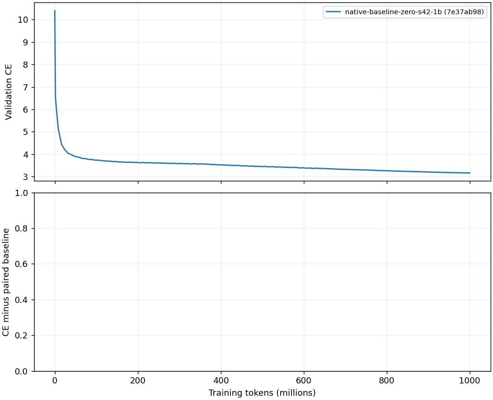
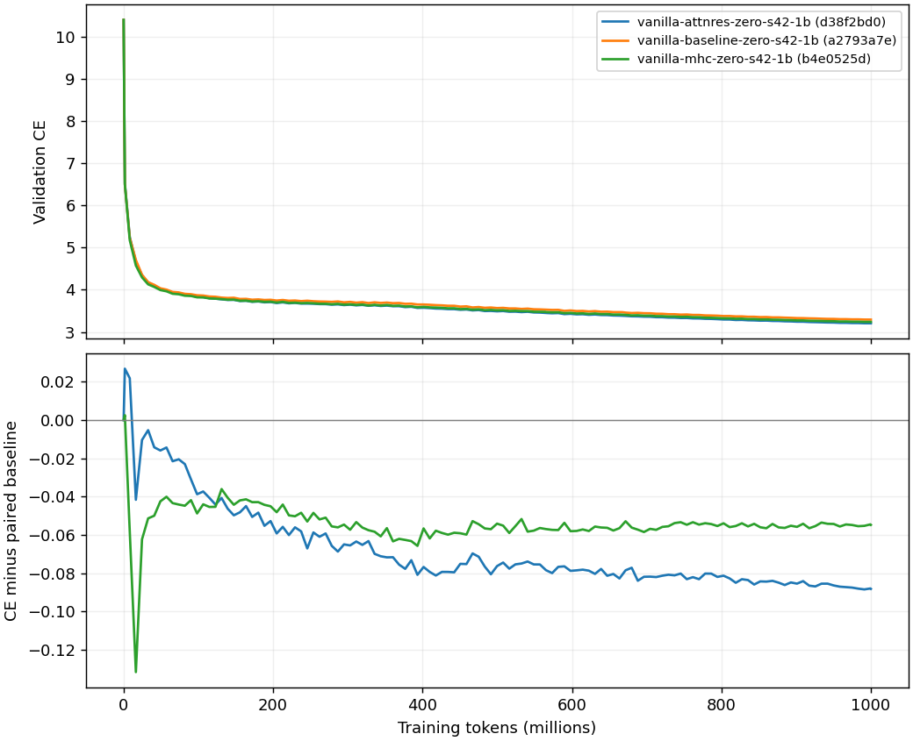

# 零输出初始化下，哪些 residual 机制改善 1B 预训练？

## 假设与实验设计

在 vanilla 主干上，分别测试历史状态读取、跨流混合和球面前瞻更新能否降低相同 tokens 下的 validation CE。四种方法共用同一个 vanilla baseline。另跑一个原生 nanochat baseline，记录带 SSSL、VE 等原生设计时的水平。

| 顺序 | 主干与 residual | 实验配置 |
| --- | --- | --- |
| 1 | vanilla baseline | 标准 residual 加法，全注意力 |
| 2 | native baseline | 原生 GPT，SSSL、VE、smear、x0、backout |
| 3 | vanilla + AttnRes | Block AttnRes，S=2 个子层 |
| 4 | vanilla + mHC | 4 条流，20 次 Sinkhorn |
| 5 | vanilla + Chord Next BF16 | 以 soft force 为位移，token-dependent 控制，从 h0 生成初速度 |

每条从零开始，seed 42，8 层、宽 512、上下文 2048，使用相同 packed FineWeb-Edu 数据顺序和 30,518 步学习率日程。每层 Attention 输出和 FFN down 投影均从零开始。六系数 Chord 使用 soft-force τ=0.05。原顺序作业逐配置验证首批梯度与断点恢复。

从 h0 生成初速度的 Chord Next 已按原 ID [2e37a95d](../legacy-chord-1b/configs/2e37a95d.json) 归档。历史四标量配方和旧消融已移入 [Legacy 归档](../legacy-chord-1b/REPORT.md)。[三种初速度](../chord-initial-velocity/REPORT.md)单独比较；以切向 Chord 为参照的[球面与速度前瞻](../legacy-chord-1b/chord-components/REPORT.md)保留在归档中。

## 实验事实

<!-- sync:begin -->

| 配置 | 状态 | 验证 tokens | 最近 CE | ΔCE | 基线 |
|---|---|---:|---:|---:|---|
| [native-baseline-zero-s42-1b](configs/7e37ab98.json) | 已完成 | 1000013824 | 3.16445 | 0.00000 | self |
| [vanilla-attnres-zero-s42-1b](configs/d38f2bd0.json) | 已完成 | 1000013824 | 3.20451 | -0.08814 | a2793a7e |
| [vanilla-baseline-zero-s42-1b](configs/a2793a7e.json) | 已完成 | 1000013824 | 3.29265 | 0.00000 | self |
| [vanilla-mhc-zero-s42-1b](configs/b4e0525d.json) | 已完成 | 1000013824 | 3.23794 | -0.05472 | a2793a7e |

[完整验证曲线数据](curves.csv)

<!-- sync:end -->

## 分析、结论与待验证问题

主要判据是 vanilla 组在相同 token 点的 ΔCE 和完整学习曲线，同时报告参数量、理论 FLOPs、吞吐、峰值显存及训练时间。Native baseline 独立列出。待验证哪种机制能在 1B 预算内持续改善 CE，以及改善对应多少训练开销。

<!-- agent:begin -->

<!-- reviewed: 7e37ab98@已完成@1000013824@3.16445@0.00000,d38f2bd0@已完成@1000013824@3.20451@-0.08814,a2793a7e@已完成@1000013824@3.29265@0.00000,b4e0525d@已完成@1000013824@3.23794@-0.05472 -->

**实测结论** 5 个配置均以 seed 42 完成 1,000,013,824 tokens。在零输出初始化的 vanilla 主干上，基线最终验证 CE 为 3.29265，Chord Next、AttnRes 和 mHC 分别降至 3.19696、3.20451 和 3.23794，对应 ΔCE 为 −0.09569、−0.08814 和 −0.05472。Native 基线的 CE 为 3.16445，但其主干和注意力协议不同，本组缺少可单独衡量 residual 贡献的 native 配对对照。

**分析** 在 vanilla 组的共同验证点上，mHC 在 819.2 万至 4,096 万 tokens 之间领先，Chord 从 4,915.2 万 tokens 起一直领先，AttnRes 从约 1.31 亿 tokens 起持续优于 mHC，最终与 Chord 仅差 0.00755 CE。同款 H100 上，相对 vanilla 基线，Chord、AttnRes、mHC 的训练吞吐分别下降 20.0%、16.1%、27.8%，峰值显存也从 5.37 GiB 分别升至 6.39、7.42、8.66 GiB。推测 AttnRes 较高的吞吐可能缩小它在相同训练时长下与 Chord 的 CE 差距，现有实验只验证了单一种子的等 token 结果。

**待验证** 若给 Chord 和 AttnRes 相同的 H100 训练时长，并用多个随机种子做配对复验，Chord 的最终验证 CE 是否仍稳定更低？

<!-- agent:end -->
